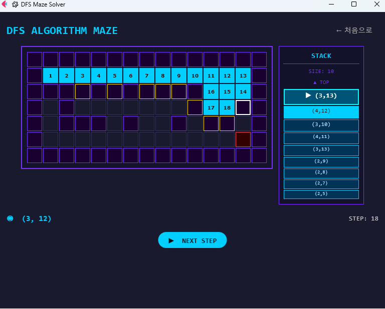
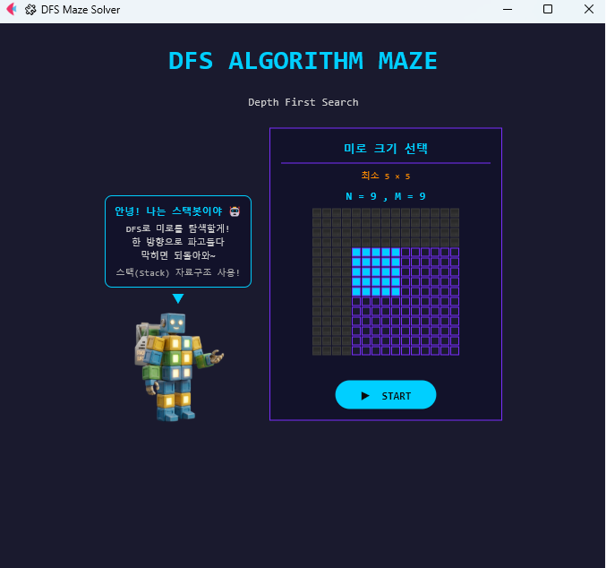
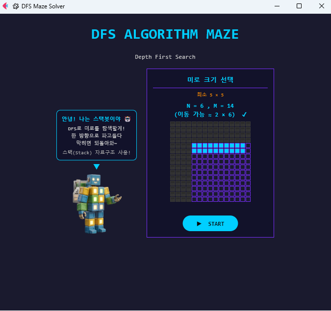
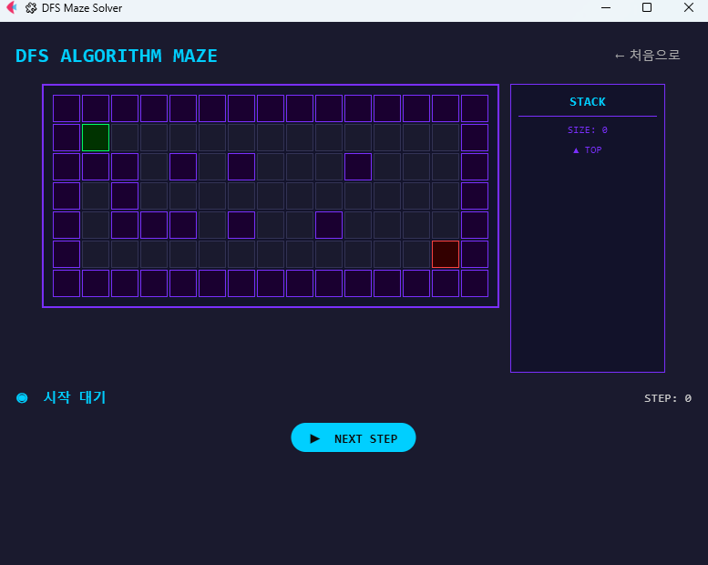
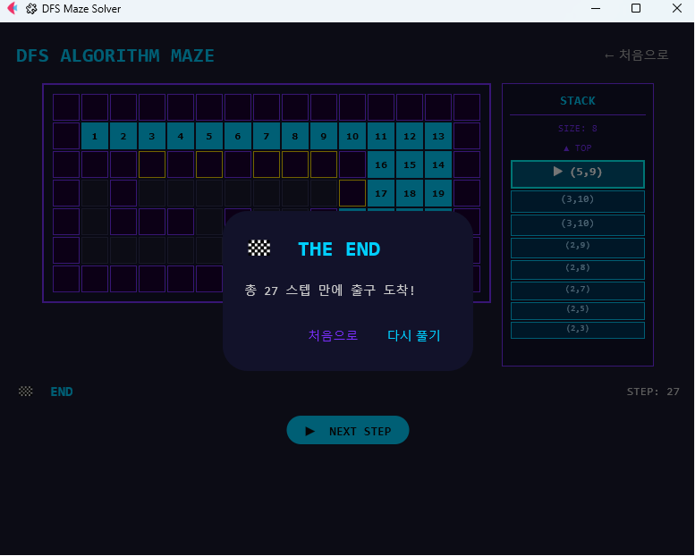

# DFS Algorithm Maze &nbsp;&nbsp;&nbsp;&nbsp;&nbsp;<sup><sub>2026.06</sub></sup>

Python과 Flet으로 만든 DFS(깊이 우선 탐색) 미로 시각화 앱.

스택(Stack) 자료구조를 직접 구현하고, 탐색 과정을 한 스텝씩 화면에서 확인.




## 핵심 코드

### 스택 ADT

[maze_logic.py](maze_logic.py) · [이론 정리](https://github.com/Jenny5789/python/blob/main/study_archive/data_structures/04_stack.py)

파이썬 리스트를 고정 크기 배열처럼 쓰고, top 인덱스로 후입선출(LIFO) 구현.

```python
class ADT_stack:
    def __init__(self, capacity=1000):
        self.maxsize = capacity
        self.bag = [None] * self.maxsize   # 고정 크기 리스트
        self.top = -1                      # 맨 위 요소의 인덱스, -1이면 비어 있음

    def push(self, e):
        if self.top < self.maxsize - 1:
            self.top += 1
            self.bag[self.top] = e
            return True
        return False                       # 가득 차면 예외 대신 False

    def pop(self):
        if self.top != -1:
            popped = self.bag[self.top]
            self.bag[self.top] = None
            self.top -= 1
            return popped
        return None                        # 비어 있으면 예외 대신 None
```

### DFS 탐색

[maze_logic.py](maze_logic.py) · [이론 정리](https://github.com/Jenny5789/python/blob/main/study_archive/data_structures/05_DFS.py)

DFS는 막히면 가장 최근 갈림길로 돌아가는 탐색이라, 다음에 갈 칸을 스택에 쌓아 두고 하나씩 꺼내 방문.<br>
**한 스텝** = NEXT STEP 버튼 1회 = `step()` 1회 = 칸 1개 방문

```python
def step(self):
    if self.stack.isEmpty():            # 더 갈 곳이 없으면 탐색 실패
        return None, None, "탐색 실패"
    current = self.stack.pop()          # 스택 맨 위 칸을 꺼내 방문
    r, c = current
    self.in_stack[r][c] = False
    if self.visited[r][c]:              # 이미 방문한 칸이면 다음 칸으로
        return self.step()
    self.visited[r][c] = True

    if current == self.exit_pos:
        return current, self.prev_pos, "출구 도착"

    pushed_any = False
    for dr, dc in DIRECTIONS:           # 안 가 본 상하좌우 이웃을 스택에 push
        nr, nc = r + dr, c + dc
        if 0 <= nr < self.rows and 0 <= nc < self.cols:
            if self.maze[nr][nc] in PASSABLE and not self.visited[nr][nc]:
                self.stack.push((nr, nc))
                self.in_stack[nr][nc] = True
                pushed_any = True
    status = "탐색 중" if pushed_any else "백트래킹"   # 넣을 이웃이 없으면 되돌아감
    # (이전 위치 기록과 반환 부분은 생략)
```

## 주요 기능

| 기능 | 설명 |
|---|---|
| 미로 크기 선택 | 15x15 격자에서 hover, 클릭으로 5x5 이상 크기 선택<br>짝수는 홀수로 보정 |
| 미로 자동 생성 | [재귀](https://github.com/Jenny5789/python/blob/main/study_archive/theory/08_functions.md) DFS로 시작할 때마다 새 미로 생성<br>시작점 좌상단, 출구 우하단 고정 |
| 단계별 탐색 | NEXT STEP 버튼으로 한 스텝씩 진행<br>현재 좌표와 STEP 수 표시 |
| 스택 시각화 | 우측 패널에 스택 후보 좌표 표시(최대 15개, 초과분은 개수만 표시)<br>최상단 강조 |
| 셀 상태 구분 | 방문 순서 번호(시안), 백트래킹(주황 X 표시)<br>스택 후보(노랑 테두리), 다음 탐색 1순위(흰 테두리), 출구 도착(별 표시) |
| 완료 팝업 | 총 스텝 수 표시<br>처음으로 또는 같은 크기의 새 미로로 다시 풀기 |
| 코드 구조 | 탐색 상태는 DFS_MazeSolver [클래스](https://github.com/Jenny5789/python/blob/main/study_archive/theory/14_classes_oop.md)로 관리<br>로직(maze_logic.py)은 UI와 [모듈](https://github.com/Jenny5789/python/blob/main/study_archive/theory/06_import_namespace.md)로 분리해 Flet 없이 동작 |

<details>
<summary>전체 화면 보기</summary>

| 시작 화면 | 크기 선택 |
|---|---|
|  |  |

| 탐색 전 | 완료 화면 |
|---|---|
|  |  |

</details>

## 파일 구조

```
DFS-algorithm-maze/
├── main.py            # 진입점
├── maze_logic.py      # DFS 알고리즘, 미로 생성, 스택 자료구조
├── maze_screen.py     # 탐색 화면 UI
├── start_screen.py    # 시작 화면 UI
├── utils.py           # 공통 상수와 유틸 함수
├── robot.png          # 시작 화면 이미지
├── images/            # README 스크린샷
└── README.md
```

## 실행 방법

Python 3.10 이상, Flet 0.80.0 이상.

```
pip install flet
python main.py
```
