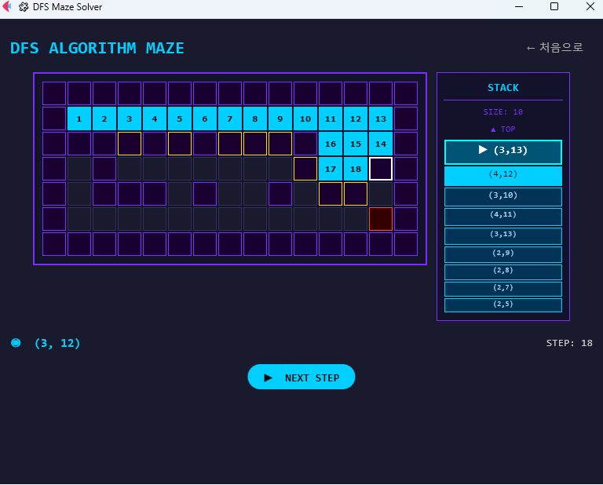
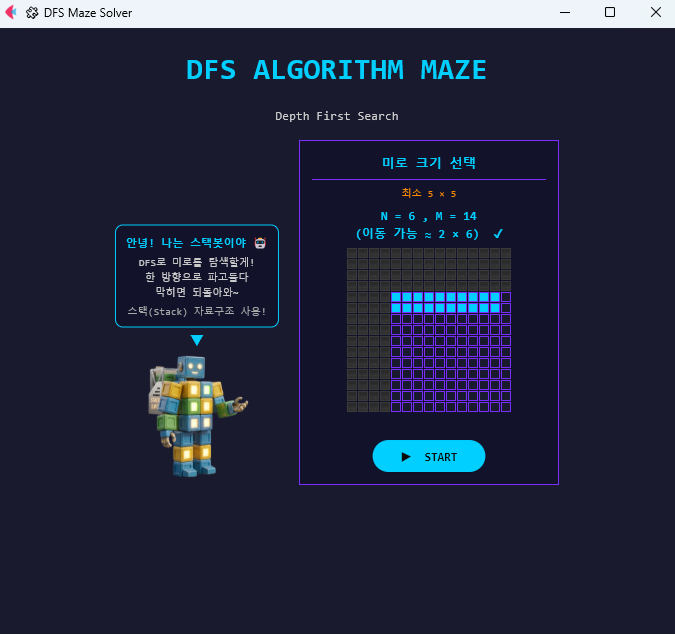
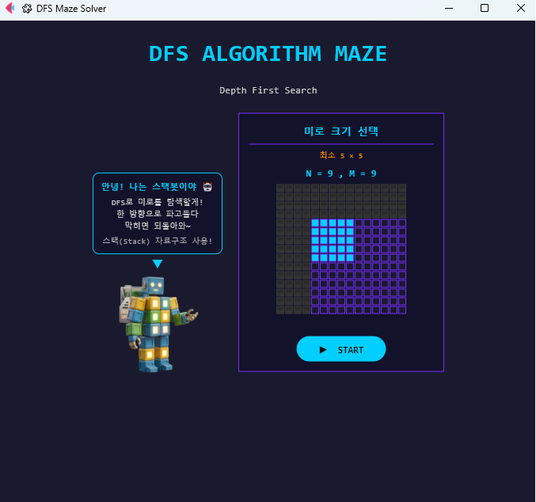
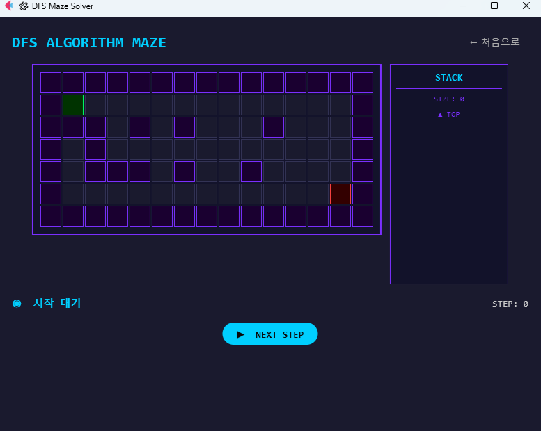
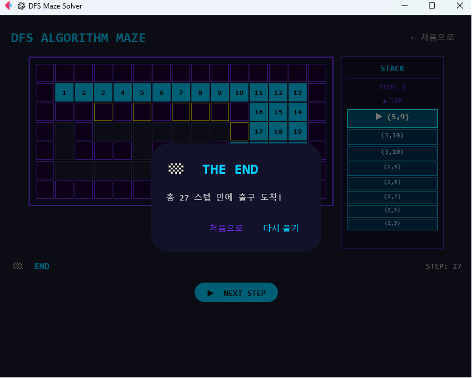

# DFS Algorithm Maze

Python과 Flet으로 만든 DFS(깊이 우선 탐색) 미로 시각화 앱.

스택(Stack) 자료구조를 직접 구현하고, 탐색 과정을 한 스텝씩 화면에서 확인.


## 기술 스택

| 구분 | 기술 | 용도 |
|---|---|---|
| 언어 | Python 3 | 전체 앱 코드 |
| 표준 라이브러리 | random | 미로 생성 시 방향 무작위화(shuffle), 루프 추가 위치 선택(randrange) |
| 표준 라이브러리 | os | 이미지 파일 경로 계산(os.path) |
| 외부 라이브러리 | flet | 시작 화면, 탐색 화면, 스택 패널, 완료 팝업(AlertDialog) UI |

## 구현 역량

스택 ADT 직접 구현, 스택 기반 DFS 탐색, 탐색 과정 단계별 시각화.

관련 이론 문서와 코드는 [파이썬 기초 역량 정리](https://github.com/Jenny5789/python/tree/main/study_archive) 참조.

| 역량 | 구현 내용 | 코드 | 이론 |
|---|---|---|---|
| 스택 ADT 구현 | 고정 크기 리스트(bag)와 top 인덱스로 push, pop, isEmpty 구현<br>가득 찬 스택과 빈 스택은 반환값으로 처리 | [핵심 코드](#핵심-코드) | [스택 ADT](https://github.com/Jenny5789/python/blob/main/study_archive/data_structures/04_stack.py) |
| DFS 탐색 | 스택에서 pop, 방문 표시, 상하좌우 이웃 push 반복<br>이웃이 없으면 백트래킹, 출구 도착 시 종료<br>한 스텝씩 실행 | [핵심 코드](#핵심-코드) | [스택을 이용한 미로 탐색](https://github.com/Jenny5789/python/blob/main/study_archive/data_structures/05_DFS.py) |
| 미로 생성 | 재귀 DFS 백트래킹으로 통로 생성, 방향 shuffle<br>짝수 크기는 홀수로 보정<br>벽 일부 제거로 루프 추가 | [maze_logic.py](maze_logic.py) | [함수와 재귀](https://github.com/Jenny5789/python/blob/main/study_archive/theory/08_functions.md) |
| 클래스 설계 | DFS_MazeSolver 클래스에 스택, 방문 여부(visited), 스택 포함 여부(in_stack) 상태 캡슐화 | [maze_logic.py](maze_logic.py) | [클래스와 객체지향](https://github.com/Jenny5789/python/blob/main/study_archive/theory/14_classes_oop.md) |
| UI 시각화 | 격자 hover, 클릭으로 크기 선택<br>셀 상태별 색 표시, 스택 패널, 완료 팝업 구현 | [start_screen.py](start_screen.py)<br>[maze_screen.py](maze_screen.py) | - |
| 모듈 분리 | 진입점, 로직, 화면 2개, 유틸 5개 파일로 분리<br>로직(maze_logic.py)은 UI 라이브러리 미사용 | [main.py](main.py) | [import와 모듈](https://github.com/Jenny5789/python/blob/main/study_archive/theory/06_import_namespace.md) |

## 핵심 코드

### 스택 ADT

[maze_logic.py](maze_logic.py)

```python
class ADT_stack:
    def __init__(self, capacity=1000):
        self.maxsize = capacity
        self.bag = [None] * self.maxsize   # 고정 크기 리스트
        self.top = -1                      # 맨 위 요소의 인덱스, -1이면 비어 있음

    def push(self, e):
        if self.top < self.maxsize - 1:
            self.top += 1
            self.bag[self.top] = e
            return True
        return False                       # 가득 참

    def pop(self):
        if self.top != -1:
            popped = self.bag[self.top]
            self.bag[self.top] = None
            self.top -= 1
            return popped
        return None                        # 비어 있음
```

- 파이썬 리스트를 고정 크기 배열처럼 사용, top 인덱스로 후입선출 구현
- 가득 참, 빈 스택은 예외 대신 False, None 반환

### DFS 한 스텝

[maze_logic.py](maze_logic.py)

```python
def step(self):
    current = self.stack.pop()          # 스택 맨 위 셀을 꺼내 방문
    r, c = current
    self.in_stack[r][c] = False
    if self.visited[r][c]:              # 이미 방문한 셀이면 다음 셀로
        return self.step()
    self.visited[r][c] = True

    if current == self.exit_pos:
        return current, self.prev_pos, "출구 도착"

    pushed_any = False
    for dr, dc in DIRECTIONS:           # 상하좌우 이웃을 스택에 push
        nr, nc = r + dr, c + dc
        if 0 <= nr < self.rows and 0 <= nc < self.cols:
            if self.maze[nr][nc] in PASSABLE and not self.visited[nr][nc]:
                self.stack.push((nr, nc))
                self.in_stack[nr][nc] = True
                pushed_any = True
    status = "탐색 중" if pushed_any else "백트래킹"
    # (스택이 빈 경우의 탐색 실패 처리와 이전 위치 기록은 생략)
```

- NEXT STEP 버튼을 누를 때마다 step() 한 번 실행
- 새로 push할 이웃이 없으면 백트래킹으로 판정, 스택에 남은 이전 후보로 되돌아감

## 주요 기능

| 기능 | 설명 |
|---|---|
| 미로 크기 선택 | 15x15 격자에서 hover, 클릭으로 5x5 이상 크기 선택<br>짝수는 홀수로 보정 |
| 미로 자동 생성 | 시작할 때마다 새 미로 생성<br>시작점 좌상단, 출구 우하단 고정 |
| 단계별 탐색 | NEXT STEP 버튼으로 한 스텝씩 진행<br>현재 좌표와 STEP 수 표시 |
| 스택 시각화 | 우측 패널에 스택 후보 좌표 표시(최대 15개, 초과분은 개수만 표시)<br>최상단 강조 |
| 셀 상태 구분 | 방문 순서 번호(시안), 백트래킹(주황 X 표시)<br>스택 후보(노랑 테두리), 다음 탐색 1순위(흰 테두리), 출구 도착(별 표시) |
| 완료 팝업 | 총 스텝 수 표시<br>처음으로 또는 같은 크기의 새 미로로 다시 풀기 |




<details>
<summary>전체 화면 보기</summary>

**시작 화면**



**탐색 전**



**완료 화면**



</details>

## 파일 구조

```
DFS-algorithm-maze/
├── main.py            # 진입점
├── maze_logic.py      # DFS 알고리즘, 미로 생성, 스택 자료구조
├── maze_screen.py     # 탐색 화면 UI
├── start_screen.py    # 시작 화면 UI
├── utils.py           # 공통 상수와 유틸 함수
├── robot.png          # 시작 화면 이미지
├── images/            # README 스크린샷
└── README.md
```

## 실행 방법

Python 3.10 이상, Flet 0.80.0 이상.

```
pip install flet
python main.py
```